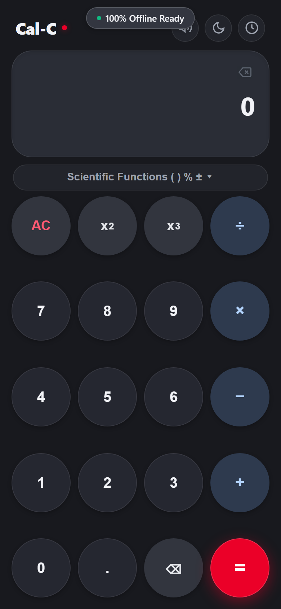
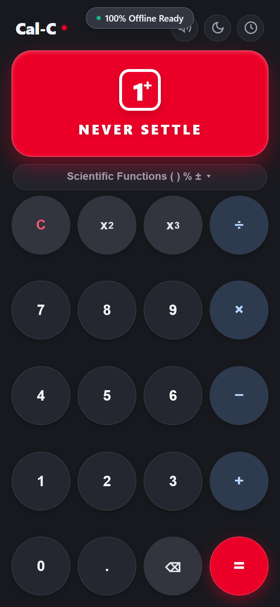

# Cal-C 🧮

A mobile-first, 100% offline **Material 3 Expressive** calculator app crafted with fluid spring physics, tactile squircle morphing buttons, the iconic OnePlus "1+" Easter Egg, and a complete native Android wrapper.

---

## ✨ Features

- **Material 3 Expressive Design**:
  - Tactile, fluid physics curves (`cubic-bezier(0.34, 1.56, 0.64, 1)`).
  - Tonal color elevations with seamless Dark and Light theme switching.
  - Interactive radial ink ripples and Web Audio acoustic clicks.
- **Pure Circle ➔ Squircle Morphing Keypad**:
  - All keypad buttons are pure circles (`border-radius: 50%`, `1:1` aspect ratio).
  - When clicked or tapped, buttons dynamically morph into squircles (`border-radius: 26%`) with a physics-based bouncy spring rebound.
- **Top Row Powers**:
  - Dedicated **Square ($x^2$)** and **Cube ($x^3$)** buttons positioned right in the top row.
- **Permanent OnePlus Red "=" Button**:
  - The `=` key is permanently styled in authentic OnePlus Red (`#EB0028`) with bold white text across both dark and light themes.
- **Iconic OnePlus Easter Egg**:
  - When the input expression is exactly `"1+"` and `=` is clicked:
    - The display card morphs into **#EB0028** (OnePlus Red).
    - Displays **ONLY** the boxed `"1+"` icon and **"NEVER SETTLE"** in white bold uppercase text.
    - Zero extra labels, subtitles, or duplicate top expression text.
    - Accompanied by a celebratory two-tone acoustic chime.
- **100% Offline Native Android Wrapper**:
  - Native Kotlin Android wrapper (`com.calc.app.MainActivity`).
  - Google AndroidX `WebViewAssetLoader` serving bundled assets (`https://appassets.androidplatform.net/assets/index.html`) completely offline without CORS or security issues.
  - Edge-to-edge layout, hardware acceleration enabled, native back press handling, and vibration permissions.
- **Automated GitHub Actions CI/CD**:
  - Pre-configured `.github/workflows/build-apk.yml` workflow.
  - Automatically compiles and produces a downloadable debug APK (`cal-c-debug-apk`) on every push or manual workflow dispatch.

---

## 🤖 Android Project Architecture

```text
cal-c/
├── .github/
│   └── workflows/
│       └── build-apk.yml               # GitHub Actions workflow for building & uploading debug APK
├── gradle/
│   └── wrapper/
│       └── gradle-wrapper.properties   # Gradle 8.7 distribution
├── gradlew                             # Linux/macOS Gradle wrapper
├── gradlew.bat                         # Windows Gradle wrapper
├── build.gradle.kts                    # Root project build configuration
├── settings.gradle.kts                 # Project & repository settings
├── gradle.properties                   # JVM args & AndroidX settings
├── app/
│   ├── build.gradle.kts                # Application module (SDK 34, MinSDK 24)
│   ├── proguard-rules.pro              # Proguard configuration
│   └── src/
│       └── main/
│           ├── AndroidManifest.xml     # App manifest (theme, permissions, launcher activity)
│           ├── assets/                 # 100% offline bundled web assets
│           │   ├── index.html
│           │   ├── style.css
│           │   ├── app.js
│           │   ├── manifest.webmanifest
│           │   └── icons/
│           │       └── icon-512.svg
│           ├── java/
│           │   └── com/
│           │       └── calc/
│           │           └── app/
│           │               └── MainActivity.kt  # Edge-to-edge Kotlin Android wrapper
│           └── res/
│               ├── drawable/
│               ├── mipmap-anydpi-v26/
│               ├── values/
│               └── values-night/
├── index.html                          # Standalone web version
├── style.css
├── app.js
└── README.md
```

---

## 📸 Screenshots

| Initial Keypad (Pure Circles) | OnePlus Easter Egg ("1+" + "=") |
| :---: | :---: |
|  |  |

---

## 📦 How to Compile the Downloadable APK

### Option 1: Via GitHub Actions (Recommended)

1. The repository is configured with:
   ```bash
   git remote add origin https://github.com/randomboss-67/Cal-C.git
   git push -u origin main
   ```
2. Navigate to the **Actions** tab on [https://github.com/randomboss-67/Cal-C/actions](https://github.com/randomboss-67/Cal-C/actions).
3. The workflow **"Build & Release Debug APK"** will automatically trigger. You can also trigger it manually anytime by selecting **Run workflow** (`workflow_dispatch`).
4. Once completed, scroll to the **Artifacts** section at the bottom of the workflow run and download **`cal-c-debug-apk`**!
5. Extract the ZIP to get `app-debug.apk` and install it on any Android device.

---

### Option 2: Local Compilation with Android Studio / Gradle

1. Open this folder in **Android Studio** (Hedgehog, Iguana, Jellyfish, or newer).
2. Android Studio will automatically sync the Gradle configuration.
3. Select **Build > Build Bundle(s) / APK(s) > Build APK(s)**, or run in the terminal:
   ```bash
   ./gradlew assembleDebug
   ```
4. The generated APK will be at:
   ```text
   app/build/outputs/apk/debug/app-debug.apk
   ```

---

## 🌐 Running Locally in Web Browser

```powershell
# Using Node server
node server.mjs
```
Then visit `http://localhost:3000`.
